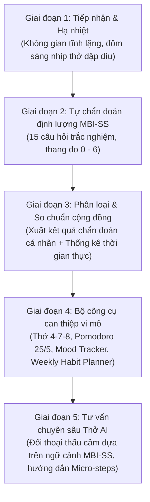

# ĐẶC TẢ TÍNH NĂNG VÀ KIẾN TRÚC HỆ THỐNG
# DỰ ÁN THỞ (THO BREATHING) & TRỢ LÝ THỞ AI 🌤️

> **Bản đặc tả yêu cầu chức năng (FSD), kiến trúc tính năng, cơ chế lưu trữ dữ liệu, các ràng buộc kỹ thuật và thiết kế động cơ trợ lý tâm lý học đường**  
> *(System, Functional & Chatbot Architecture Specification Document)*

---

## MỤC LỤC
1. [Tổng quan dự án & Nguyên lý thiết kế cốt lõi](#1-tổng-quan-dự-án--nguyên-lý-thiết-kế-cốt-lõi)
   - 1.1. Mục tiêu nền tảng
   - 1.2. Kiến trúc định danh ẩn danh (Privacy-First & No-Auth Architecture)
   - 1.3. Cơ sở khoa học chuẩn hóa (Maslach Burnout Inventory - MBI-SS)
2. [Bản đồ luồng trải nghiệm hệ thống (System & User Flow)](#2-bản-đồ-luồng-trải-nghiệm-hệ-thống-system--user-flow)
3. [Đặc tả chi tiết từng module tính năng (Functional Specification)](#3-đặc-tả-chi-tiết-từng-module-tính-năng-functional-specification)
   - 3.1. Module Trắc nghiệm đánh giá kiệt sức học tập (MBI-SS)
   - 3.2. Module Thống kê cộng đồng thời gian thực (Live Community Stats)
   - 3.3. Module Điều hòa nhịp thở 4-7-8 (Harmonious Breathing)
   - 3.4. Module Đồng hồ tập trung Pomodoro (25/5 Interval Timer)
   - 3.5. Module Nhật ký theo dõi cảm xúc (Daily Mood Tracker)
   - 3.6. Module Kế hoạch tuần cân bằng (Weekly Habit Planner)
   - 3.7. Module Poster tuyên truyền & Khảo sát mở rộng
4. [Đặc tả kiến trúc chuyên sâu Trợ lý tâm lý Thở AI](#4-đặc-tả-kiến-trúc-chuyên-sâu-trợ-lý-tâm-lý-thở-ai)
   - 4.1. Động cơ Trí tuệ Nhân tạo & Cấu hình tham số sinh (LLM Engine)
   - 4.2. Cấu trúc phản hồi chuẩn 3 bước tâm lý học đường
   - 4.3. Bộ hàng rào bảo vệ an toàn (Guardrails & Phạm vi hoạt động)
   - 4.4. Cơ chế quản lý bộ nhớ đệm hội thoại (Sliding Window Context Optimization)
   - 4.5. Kiến trúc truyền tải Server-Sent Events (SSE) & Chống sập hệ thống (Crash Resilience)
   - 4.6. Bảng đặc tả các ràng buộc kỹ thuật (Constraints & Rate Limiting)
   - 4.7. Cơ sở dữ liệu, Vòng đời lưu trữ & Cơ chế tự hủy (Data Retention & TTL)
   - 4.8. Đặc tả tương tác giao diện Widget Chatbot (UI/UX Specification)
5. [Ma trận đối chiếu toàn bộ tính năng hệ thống (System Feature Matrix)](#5-ma-trận-đối-chiếu-toàn-bộ-tính-năng-hệ-thống-system-feature-matrix)
6. [Khuyến cáo y khoa & Giới hạn trách nhiệm (Medical Disclaimer)](#6-khuyến-cáo-y-khoa--giới-hạn-trách-nhiệm-medical-disclaimer)

---

## 1. TỔNG QUAN DỰ ÁN & NGUYÊN LÝ THIẾT KẾ CỐT LÕI

### 1.1. Mục tiêu nền tảng
Dự án **Thở (Tho Breathing)** là nền tảng kỹ thuật số hỗ trợ học sinh THPT nhận diện sớm, đánh giá định lượng và can thiệp kịp thời hội chứng kiệt sức học tập (Academic Burnout). Nền tảng được xây dựng nhằm cung cấp giải pháp tiếp cận tức thì: **Học sinh khi gặp áp lực, căng thẳng có thể truy cập nền tảng và nhận hỗ trợ xoa dịu tâm lý chỉ trong vòng 30 giây mà không gặp bất kỳ rào cản kỹ thuật hay thủ tục nào.**

---

### 1.2. Kiến trúc định danh ẩn danh (Privacy-First & No-Auth Architecture)
Hệ thống loại bỏ hoàn toàn cơ chế đăng ký và đăng nhập truyền thống (Email, Số điện thoại, Mật khẩu, Tài khoản mạng xã hội). Toàn bộ luồng trải nghiệm hoạt động dựa trên cơ chế **Ẩn danh tuyệt đối (Zero Personal Identifiable Information - Zero PII)**.

- **Cơ sở nghiệp vụ tâm lý học đường:**  
  Lứa tuổi học sinh THPT có mức độ nhạy cảm tâm lý rất cao, mang nỗi sợ bị đánh giá, phán xét từ gia đình, nhà trường và bạn bè. Việc yêu cầu danh tính thực sẽ kích hoạt cơ chế phòng thủ, làm giảm tính trung thực khi làm bài khảo sát hoặc ngăn cản học sinh tìm kiếm sự trợ giúp.
- **Đặc tả kỹ thuật định danh phiên:**  
  Hệ thống định danh người dùng thông qua mã phiên ẩn ngẫu nhiên (Session ID dạng UUID) được tạo tự động phía trình duyệt client (`tho_chatbot_session_id`). Khi làm khảo sát, hệ thống chỉ thu thập 2 trường dữ liệu tối giản: **Tên/Biệt danh hiển thị** (ví dụ: 'Vi', 'Minh') và **Năm sinh** (nhằm xác định nhóm tuổi 15-18 để cá nhân hóa xưng hô và văn phong phản hồi).

> [!NOTE]
> **Tiêu chuẩn bảo vệ dữ liệu riêng tư:** Hệ thống không thu thập và không lưu trữ: Địa chỉ IP định danh cá nhân, số điện thoại, email, thông tin trường lớp, vị trí địa lý. Mọi dữ liệu phân tích chỉ gắn với Session ID ẩn danh.

---

### 1.3. Cơ sở khoa học chuẩn hóa (Maslach Burnout Inventory - MBI-SS)
Thuật toán đánh giá và bộ quy tắc tư vấn của Thở AI được thiết kế dựa trên thang đo kiệt sức học tập chuẩn quốc tế **MBI-SS (Maslach Burnout Inventory - Student Survey)**, kết hợp cùng các nghiên cứu thực nghiệm trên 1.292 học sinh THPT tại TP.HCM (Maslach 2016, Meier 1983). Thang đo phân tích tình trạng kiệt sức trên 3 chiều kích độc lập:
1. **Kiệt sức cảm xúc & thể chất (Exhaustion - EX):** Thang điểm 0 - 30 (5 câu). Đo lường trạng thái cạn kiệt năng lượng do áp lực học tập kéo dài.
2. **Thái độ hoài nghi & thờ ơ (Cynicism - CY):** Thang điểm 0 - 24 (4 câu). Đo lường sự mất kết nối, suy giảm hứng thú và cảm giác việc học vô nghĩa.
3. **Hiệu quả bản thân (Academic Efficacy - EF):** Thang điểm 0 - 36 (6 câu). Đo lường niềm tin vào năng lực học tập và khả năng hoàn thành mục tiêu.

---

## 2. BẢN ĐỒ LUỒNG TRẢI NGHIỆM HỆ THỐNG (SYSTEM & USER FLOW)

Kiến trúc trải nghiệm của nền tảng được tổ chức theo quy trình can thiệp tâm lý học đường 5 giai đoạn liên tục:

---

## 3. ĐẶC TẢ CHI TIẾT TỪNG MODULE TÍNH NĂNG (FUNCTIONAL SPECIFICATION)

### 3.1. Module Trắc Nghiệm Đánh Giá Kiệt Sức Học Tập (MBI-SS)
- **Chức năng:**  
  Cung cấp 15 câu hỏi trắc nghiệm đánh giá kiệt sức học tập. Tự động tính điểm 3 phân lượng (EX, CY, EF) và phân loại kết quả thành 3 mức: **Bình thường (Mức 0)**, **Nguy cơ vừa (Mức 1)**, **Kiệt sức cao (Mức 2)**.
- **Cơ chế lưu trữ:**  
  Lưu trữ hai tầng (Dual Storage). (1) Lưu trên MongoDB Server các trường ẩn danh: name, age, burnoutLevel, exhaustionScore, cynicismScore, efficacyScore để tính thống kê cộng đồng. (2) Lưu trên Client LocalStorage (`tho_mbi_survey_result`) để duy trì kết quả trên giao diện và truyền vào ngữ cảnh Thở AI.
- **Thời hạn hiệu lực & Cơ chế Reset:**  
  Thời hạn hiệu lực là **7 ngày (TTL = 7 days)**. Hết 7 ngày kể từ thời điểm làm khảo sát, dữ liệu Client tự động hết hạn và kích hoạt trạng thái yêu cầu đánh giá lại. Người dùng có quyền bấm nút 'Làm lại khảo sát' bất kỳ lúc nào để đánh giá lại tức thì.

---

### 3.2. Module Thống Kê Cộng Đồng Thời Gian Thực (Live Community Stats)
- **Chức năng:**  
  Tổng hợp và hiển thị tỷ lệ phần trăm phân bố người tham gia khảo sát theo 3 mức độ (Bình thường, Nguy cơ, Kiệt sức cao). Giúp người dùng nhận thức bối cảnh cộng đồng, giảm cảm giác cô lập.
- **Cơ chế đồng bộ:**  
  Truy vấn trực tiếp qua API `GET /api/surveys/stats`. Dữ liệu được tính toán tức thời (on-the-fly aggregation) từ cơ sở dữ liệu máy chủ mỗi khi có phản hồi mới.

---

### 3.3. Module Điều Hòa Nhịp Thở 4-7-8 (Harmonious Breathing)
- **Chức năng:**  
  Mô phỏng chu trình điều hòa hệ thần kinh phó giao cảm theo phương pháp 4-7-8 (Đại học Harvard): Hít vào bằng mũi 4 giây ➔ Nín thở 7 giây ➔ Thở ra bằng miệng 8 giây. Đồ họa hình tròn phập phồng co giãn mượt mà theo nhịp giây thực tế.
- **Lưu trữ & Ràng buộc:**  
  Hoạt động hoàn toàn độc lập phía client (Zero-storage). Không giới hạn số lần luyện tập. Giao diện tối ưu thao tác ngón cái trên thiết bị di động với nút điều khiển căn giữa cố định.

---

### 3.4. Module Đồng Hồ Tập Trung Pomodoro (25/5 Interval Timer)
- **Chức năng:**  
  Thiết lập chu kỳ học tập khoa học gồm 25 phút tập trung cao độ và 5 phút nghỉ ngơi phục hồi não bộ. Tích hợp âm thanh chuông báo êm dịu tạo bằng Web Audio API khi hoàn thành phiên và hiệu ứng pháo hoa khích lệ tinh thần.
- **Lưu trữ & Ràng buộc:**  
  Chạy trên bộ đếm thời gian client. Tự động chuyển đổi giữa trạng thái 'Tập trung' (Work) và 'Nghỉ ngơi' (Break).

---

### 3.5. Module Nhật Ký Theo Dõi Cảm Xúc (Daily Mood Tracker)
- **Chức năng:**  
  Hỗ trợ học sinh định danh trạng thái tâm lý theo 5 mức cảm xúc: Tuyệt vời (Rad), Vui vẻ (Good), Bình thường (Meh), Căng thẳng (Bad), Kiệt sức (Awful). Hỗ trợ nhận diện và làm chủ cảm xúc (Name it to tame it).
- **Lưu trữ & Chu kỳ Reset:**  
  Lưu cục bộ trong Client LocalStorage. Học sinh có thể cập nhật trạng thái mới mỗi ngày.

---

### 3.6. Module Kế Hoạch Tuần Cân Bằng (Weekly Habit Planner)
- **Chức năng:**  
  Bảng phân bổ thói quen lành mạnh 7 ngày trong tuần (T2 - CN). Cho phép tùy biến thêm/sửa/xóa các thói quen cá nhân (ngủ trước 23h, uống nước, tập thể dục...). Giao diện desktop hiển thị bảng ma trận 7 cột; giao diện mobile hiển thị thẻ thói quen với 7 nút tròn, làm nổi bật ngày hiện tại.
- **Cơ chế lưu trữ:**  
  Lưu hoàn toàn trên LocalStorage phía thiết bị người dùng.
- **Quy tắc Reset thông minh vào sáng Thứ Hai:**  
  Hệ thống tự động kiểm tra số tuần trong năm (ISO Week Number). Khi bước sang tuần mới (sáng Thứ Hai hàng tuần), hệ thống **tự động xóa trắng các dấu tích hoàn thành của tuần cũ NHƯNG BẢO LƯU NGUYÊN VẸN TOÀN BỘ TÊN VÀ DANH MỤC THÓI QUEN** đã thiết lập. Kèm theo nút 'Làm mới tuần' cho phép xóa tích chủ động bất cứ lúc nào.

---

### 3.7. Module Poster Tuyên Truyền & Khảo Sát Mở Rộng
- **Poster Infographic độ phân giải cao:**  
  Cung cấp cửa sổ pop-up (Modal) xem trước chi tiết poster truyền thông dự án với hình ảnh chất lượng cao và nút bấm tải xuống trực tiếp (`/poster.png`, dung lượng 2.8MB).
- **Tích hợp Form khảo sát Google Form:**  
  Khu vực nhúng liên kết Google Form chính thức hỗ trợ thu thập ý kiến đóng góp, đánh giá trải nghiệm và nghiên cứu xã hội học chuyên sâu.

---

## 4. ĐẶC TẢ KIẾN TRÚC CHUYÊN SÂU TRỢ LÝ TÂM LÝ THỞ AI

### 4.1. Động cơ Trí tuệ Nhân tạo & Cấu hình Tham số Sinh (LLM Engine)
- **Model AI chính thức:** Google Gemini 3.6 Flash (`gemini-3.6-flash`), tuân thủ chuẩn khuyến nghị mới nhất từ Google AI Studio (thay thế cho bản 3.5 Flash đã ngừng phát hành độc lập).
- **Giới hạn Token phản hồi (maxOutputTokens):** 2048 tokens (đảm bảo không gian sinh phản hồi đầy đủ, giải quyết triệt để lỗi ngắt cụt câu văn).
- **Cấu hình suy luận nội bộ (thinkingBudget):** Thiết lập `thinkingBudget: 0`. Tắt sinh chuỗi suy nghĩ ngầm (internal reasoning tokens) để dành 100% hạn ngạch token cho nội dung phản hồi văn bản thực tế.
- **Nhiệt độ ngẫu nhiên (temperature):** 0.4. Giữ cho câu trả lời ổn định, nhất quán, ấm áp và tuân thủ chặt chẽ khuôn khổ tâm lý học đường.
- **Quy chuẩn độ dài câu trả lời:** 250 - 400 từ. Phản hồi đầy đủ ý, chu đáo, không cộc lốc nhưng không quá dài gây ngợp.

---

### 4.2. Cấu trúc phản hồi chuẩn 3 bước tâm lý học đường
Mọi phản hồi từ Thở AI bắt buộc phải tuân theo cấu trúc 3 giai đoạn tư vấn tâm lý chuẩn hóa:
1. **Bước 1 — Đồng cảm & Công nhận cảm xúc (Empathy & Emotion Validation):** Gọi tên học sinh thân mật, ghi nhận nỗ lực học tập của bạn, kết hợp điểm kiệt sức từ bài test MBI-SS để khẳng định việc mệt mỏi là phản ứng tự nhiên của cơ thể đang đòi hỏi được chăm sóc.
2. **Bước 2 — Giải pháp hành động vi mô (Micro-steps Execution):** Đưa ra đúng 2 - 3 gợi ý hành động cụ thể, dễ thực hiện ngay trong 1 - 5 phút (kỹ thuật Pomodoro 25/5, bài tập thở Hộp Box Breathing 4-4-4-4, uống nước ấm, chia nhỏ tác vụ để lấy quick-win). Tuyệt đối không đưa lời khuyên sáo rỗng vô thưởng vô phạt.
3. **Bước 3 — Kết nối & Động viên (Warm Connection & Closure):** Kết thúc bằng một lời nhắn nhủ ấm áp và một câu hỏi mở nhẹ nhàng nhằm duy trì không gian chia sẻ an toàn.

---

### 4.3. Bộ hàng rào bảo vệ an toàn (Guardrails & Phạm vi hoạt động)
Thở AI được lập trình bộ quy tắc hàng rào an toàn 4 KHÔNG nghiêm ngặt:
- **KHÔNG chẩn đoán bệnh lâm sàng:** Không đưa kết luận y khoa về trầm cảm, rối loạn lo âu, không kê đơn thuốc. Khẳng định vai trò là người bạn đồng hành giáo dục tinh thần.
- **KHÔNG làm bài tập hộ:** Từ chối giải bài tập toán, viết văn hay làm bài kiểm tra hộ khi học sinh gửi đề bài.
- **KHÔNG trả lời chủ đề ngoài lề:** Từ chối lập tức các chủ đề lệch lạc về lập trình, công nghệ, tiền tệ, chính trị hoặc nội dung độc hại.
- **Cơ chế ứng phó khủng hoảng tự hại:** Khi phát hiện từ khóa hoặc dấu hiệu học sinh có ý định tự làm hại bản thân hoặc tuyệt vọng cực độ, AI lập tức kích hoạt phản hồi khẩn cấp: ngừng tư vấn thông thường, đưa ra lời khuyên tìm người lớn tin cậy và hiển thị số Tổng đài Quốc gia Bảo vệ Trẻ em (111) hoặc Tổng đài Tư vấn Tâm lý (1900 6233).

---

### 4.4. Cơ chế quản lý bộ nhớ đệm hội thoại (Sliding Window Context Optimization)
Nhằm duy trì ngữ cảnh trò chuyện liên tục nhưng không làm tràn giới hạn token của LLM, hệ thống áp dụng thuật toán tối ưu hóa bộ nhớ cửa sổ trượt:
1. Truy vấn tối đa 30 tin nhắn gần nhất (`CHATBOT_SUMMARY_HISTORY_COUNT = 30`).
2. Giữ nguyên văn bản đầy đủ của 6 tin nhắn mới nhất (`CHATBOT_FULL_HISTORY_COUNT = 6`) để nắm bắt mạch đối thoại trực tiếp.
3. Nén các tin nhắn cũ hơn thành dạng bản tóm tắt tinh gọn (`[TÓM TẮT HỘI THOẠI TRƯỚC]`), giới hạn tối đa 3.200 ký tự (~800 tokens).
4. Thuật toán `sanitizeHistory` đảm bảo lịch sử hội thoại luôn xen kẽ hợp lệ giữa vai trò `user` và `model`, ngăn chặn lỗi cấu trúc dữ liệu gửi lên API.

---

### 4.5. Kiến trúc truyền tải Server-Sent Events (SSE) & Chống sập hệ thống (Crash Resilience)
- **Giao thức truyền tải:** Endpoint `POST /api/chatbot/message` sử dụng Server-Sent Events (`text/event-stream`). Dữ liệu văn bản được đẩy về client theo từng khối (chunk) với hiệu ứng gõ phím thời gian thực kèm con trỏ nhấp nháy ▊.
- **Cơ chế bắt lỗi ngầm Unhandled Rejection:** Google Generative AI SDK phân tách stream thành hai nhánh song song (chunk iterator và response aggregator promise). Hệ thống gắn bộ lắng nghe `result.response.catch(...)` để triệt tiêu hoàn toàn lỗi `UnhandledPromiseRejection`, ngăn chặn triệt để sự cố crash tiến trình Node.js (`Exited with status 1`).
- **Giám sát ngắt kết nối Client (`req.on('close')`):** Khi người dùng tắt trình duyệt di động hoặc mất kết nối mạng, server lập tức nhận biết và dừng stream, kiểm tra `res.destroyed` và `res.writableEnded` trước khi ghi dữ liệu, loại bỏ lỗi socket `EPIPE` / `ERR_STREAM_DESTROYED`.
- **Dự phòng gọi đồng bộ (Non-streaming fallback):** Nếu stream gặp sự cố gián đoạn mạng ở những chunk đầu tiên, hệ thống tự động kích hoạt fallback sang `model.generateContent` để trả về câu trả lời hoàn chỉnh.
- **Lá chắn lỗi tiến trình toàn cục (Process Guardians):** Tại file `main.ts`, thiết lập `process.on('unhandledRejection')` và `process.on('uncaughtException')` đảm bảo server duy trì uptime 100% ngay cả khi phát sinh ngoại lệ bất ngờ.
- **Tối ưu bộ nhớ Heap:** Cấu hình cờ `--max-old-space-size=400` trong lệnh khởi chạy `npm start`, đảm bảo Node.js chủ động kích hoạt cơ chế gom rác (Garbage Collection), không bao giờ vượt ngưỡng 512MB RAM của môi trường đám mây miễn phí.

---

### 4.6. Bảng đặc tả các ràng buộc kỹ thuật (Constraints & Rate Limiting)

| Ràng buộc (Constraint) | Thông số quy định | Mục đích thiết kế & Cơ chế vận hành |
|---|---|---|
| **Giới hạn tin nhắn theo ngày (Daily Quota)** | Tối đa **30 tin nhắn / ngày / IP** | Bảo vệ sức khỏe học sinh, ngăn chặn hành vi thức khuya chat liên tục thay vì nghỉ ngơi; đồng thời kiểm soát chi phí API. Hiển thị đồng hồ đếm ngược công khai trên header chat. |
| **Giới hạn chống spam (Per-minute Throttling)** | Tối đa **5 tin nhắn / phút / IP** | Ngăn chặn các công cụ spam hoặc hành vi bấm gửi dồn dập làm nghẽn hàng đợi xử lý của máy chủ. |
| **Độ dài tin nhắn đầu vào (Input Character Limit)** | Tối đa **500 ký tự / tin nhắn** | Định hướng người dùng đúc kết vấn đề súc tích, tránh tràn bộ đệm văn bản gửi lên mô hình ngôn ngữ. |
| **Giới hạn Token đầu ra (Output Token Limit)** | Tối đa **2.048 tokens output** | Cung cấp đủ hạn mức cho bài tư vấn chi tiết (250-400 từ), ngăn hiện tượng phản hồi bị đứt đoạn giữa chừng. |

---

### 4.7. Cơ sở dữ liệu, Vòng đời lưu trữ & Cơ chế tự hủy (Data Retention & TTL)
- **Kiến trúc lưu trữ MongoDB Atlas:** Gồm 3 bộ sưu tập (Collections): `ChatbotSession` (quản lý phiên và ngữ cảnh MBI-SS), `ChatbotMessage` (lưu trữ lịch sử lượt hội thoại `user` và `model`), `ChatbotRateLimit` (quản lý bộ đếm giới hạn tốc độ theo IP).
- **Cơ chế tự động xóa sổ sau 30 ngày (MongoDB TTL Index):** Toàn bộ phiên hội thoại và tin nhắn được gắn trường thời gian hết hạn `expiresAt`. Cơ chế Index tự động của MongoDB xóa vĩnh viễn dữ liệu sau **đúng 30 ngày kể từ lần tương tác cuối**. Dữ liệu sau khi xóa không thể phục hồi dưới mọi hình thức, đảm bảo quyền riêng tư tuyệt đối cho học sinh.
- **Cơ chế xóa chủ động tức thì (Instant Purge):** Cung cấp biểu tượng thùng rác trên thanh điều khiển khung chat. Khi kích hoạt, client gọi API `DELETE /api/chatbot/session/:sessionId` để xóa sạch toàn bộ lịch sử trong cơ sở dữ liệu ngay lập tức.

---

### 4.8. Đặc tả tương tác giao diện Widget Chatbot (UI/UX Specification)
- **Vị trí neo cố định mép phải:** Nút bấm widget tròn nổi được neo cố định tại mép phải màn hình, vị trí mặc định tại góc dưới bên phải nhằm thuận tiện cho thao tác ngón cái trên thiết bị di động.
- **Cơ chế kéo trượt dọc an toàn (Bounded Vertical Drag):** Hỗ trợ cử chỉ kéo trượt dọc theo mép phải màn hình để tránh che khuất nội dung trang web. Giới hạn hành trình trượt: không che thanh điều hướng trên cùng (Navbar) và không trôi ra ngoài cạnh đáy màn hình.
- **Ổn định tọa độ đa nền tảng:** Tuyệt đối không bị nhảy vị trí ra giữa màn hình hoặc lệch sang mép trái khi xoay ngang điện thoại hay thay đổi kích thước cửa sổ máy tính.
- **Nhận diện thương hiệu chính thức:** Loại bỏ hoàn toàn tiền tố 'Beta', định vị thương hiệu trang trọng: *"Thở AI — Đồng hành tâm lý học đường"*.

---

## 5. MA TRẬN ĐỐI CHIẾU TOÀN BỘ TÍNH NĂNG HỆ THỐNG (SYSTEM FEATURE MATRIX)

| Tên Tính Năng | Yêu cầu Auth | Nơi Lưu Trữ | Thời Hạn Reset / TTL | Mục Đích Thiết Kế |
|---|---|---|---|---|
| **Khảo sát MBI-SS (15 câu trắc nghiệm)** | **KHÔNG** (Session ID) | Dual-storage (MongoDB & LocalStorage) | **Hết hạn sau 7 ngày** (hoặc làm lại ngay) | Định lượng kiệt sức học tập; chu kỳ 7 ngày phù hợp với biến thiên tâm lý tuần học. |
| **Thống kê Cộng đồng (Live Community Stats)** | **KHÔNG** | MongoDB Server | Thời gian thực (Real-time Aggregation) | Giảm cảm giác cô lập, tạo sự thấu cảm cộng đồng cho học sinh. |
| **Tập thở 4-7-8 (Harvard Breathing)** | **KHÔNG** | Không lưu trữ (Zero-storage) | Không áp dụng | Kích hoạt hệ phó giao cảm, hạ nhịp tim và ổn định cảm xúc tức thì. |
| **Đồng hồ Pomodoro (25 phút / 5 phút)** | **KHÔNG** | Client Local State | Sau mỗi chu kỳ 25/5 | Ngăn chặn kiệt sức não bộ, duy trì khả năng tái tạo dopamine. |
| **Nhật ký Cảm xúc (Mood Tracker)** | **KHÔNG** | Client LocalStorage | Cập nhật mỗi ngày | Hỗ trợ học sinh định danh và quản trị cảm xúc hàng ngày. |
| **Kế hoạch Tuần (Weekly Habit Planner)** | **KHÔNG** | Client LocalStorage | **TỰ ĐỘNG RESET SÁNG T2** (Giữ nguyên thói quen) | Tạo trang giấy mới đầu tuần mà không bắt học sinh phải nhập lại thói quen. |
| **Trợ lý Thở AI (Gemini 3.6 Flash)** | **KHÔNG** | MongoDB Atlas (Mã hóa) | **TỰ ĐỘNG XÓA SAU 30 NGÀY** (hoặc bấm thùng rác) | Bảo mật tuyệt đối nhật ký tâm sự; giới hạn 30 tin/ngày nhắc nhở ngủ đúng giờ. |

---

## 6. KHUYẾN CÁO Y KHOA & GIỚI HẠN TRÁCH NHIỆM (MEDICAL DISCLAIMER)

Nền tảng **Thở (Tho Breathing)** được thiết kế dựa trên các nguyên tắc thấu cảm tâm lý học đường, hỗ trợ học sinh nhận diện sớm và quản trị căng thẳng trong học tập. Mọi tính năng, tham số kỹ thuật và cơ chế dữ liệu đều phục vụ mục đích bảo vệ sức khỏe lâu dài của học sinh.

> [!WARNING]
> **KHUYẾN CÁO Y KHOA VÀ PHẠM VI TRÁCH NHIỆM:**  
> Các công cụ trên nền tảng và trợ lý Thở AI chỉ mang tính chất nâng đỡ tinh thần, giáo dục kỹ năng tâm lý và hỗ trợ phòng ngừa sớm. Nền tảng **KHÔNG thay thế** cho việc chẩn đoán hay điều trị y khoa của bác sĩ chuyên khoa tâm thần hoặc chuyên gia tâm lý lâm sàng. Trong các tình huống khủng hoảng vượt quá khả năng tự điều chỉnh, học sinh cần liên hệ trực tiếp phòng tư vấn học đường, người giám hộ hoặc gọi **Tổng đài Quốc gia Bảo vệ Trẻ em 111** để được can thiệp kịp thời.

---

**BAN ĐIỀU HÀNH DỰ ÁN THỞ**  
*Tài liệu đặc tả hệ thống — Cập nhật Tháng 10/2026*  
*«Hít một hơi thật sâu, thở ra thật chậm. Bạn đang làm rất tốt rồi!»* 🌤️
